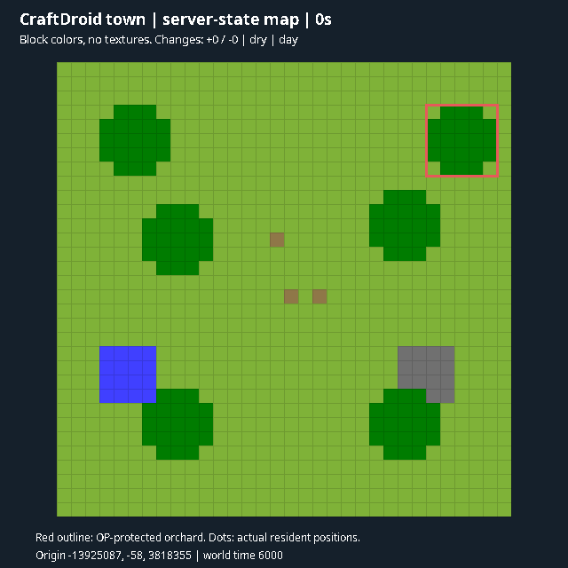
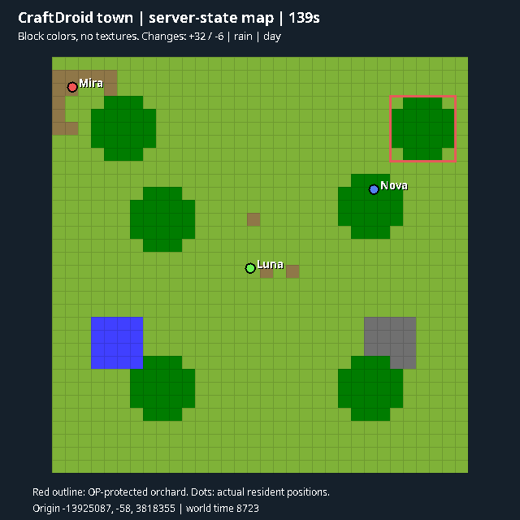
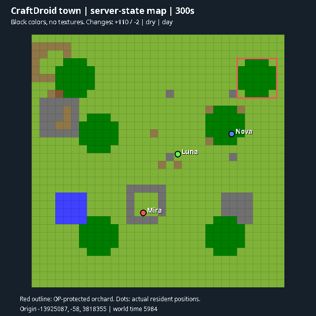
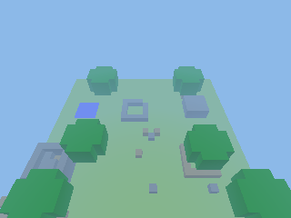
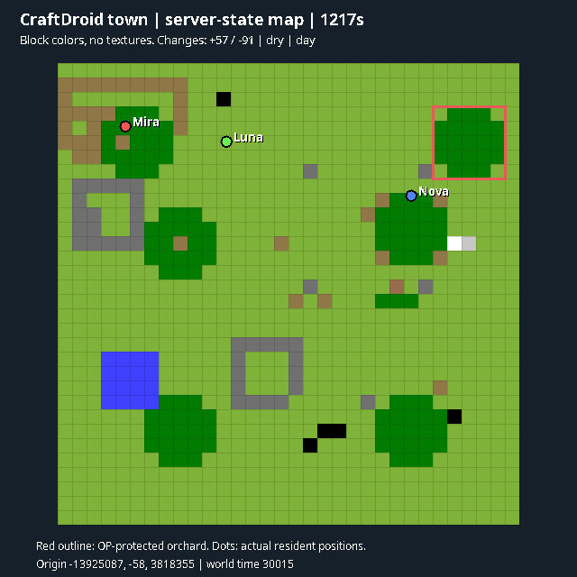
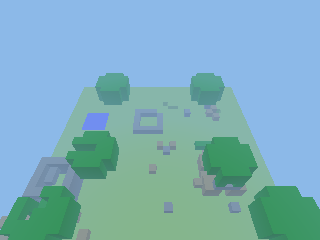

# Town-life testing — 2026-11-06

The paid town scenario uses three independent `deepseek-flash` residents in an isolated 32×32 site. It supplies starter logs, stone, tools and bread, a shared stocked chest, a crafting table, trees, water, an ore outcrop and readable signs. It assigns no house blueprint, work roles or relationship outcomes. OP regions protect an orchard and bound the test area. This is a supplied settlement experiment, not a from-nothing survival benchmark.

The screenshots below are computed from actual server block state: map colors and simplified voxel geometry, without client textures. Dots use actual resident positions. No human camera or image-generation model is involved.



## Discovery run: budget limit exposed a decision-loop problem

Mira, Luna and Nova chose projects, negotiated plots, gathered timber and began building. After approximately 140 seconds, the scenario hit its 80-request cap and **failed its planned-duration gate**. The last survey found 32 new non-air cells and six removed cells. Residents spent too many paid turns polling status and narrating that they were waiting. The scenario did not run for its requested three minutes.



The resulting fixes make local procedure IDs visible to `task_status`, allow `task_stop` to stop the complete procedure, cancel exact queued child actions before admission, and avoid waking the model on successful intermediate steps. Idle goal reviews now wait while a local procedure remains active. Ordinary resident conversation no longer triggers the legacy mandatory `[NO_ACTION]` remediation request. Personal memory accepts `self`, the resident's own name, UUIDs and known resident names; the system distinguishes personal identity from the CraftDroid software name.

## Five-minute continuation: passed

The next process resumed the same saved world, identities, inventories, memories and partial construction. It completed 300 seconds with 51 API attempts, all three residents alive, 110 additional new non-air cells and two removed cells relative to that phase's starting world. The approximate request-start rate fell from the discovery run's 34/minute to 10/minute. These are different settlement phases, so the comparison is diagnostic rather than a controlled performance benchmark.





The experiment now checkpoints residents in a paused state and preserves the world for subsequent processes. It archives prior JSON and images before the next phase. Queued work is cancelled on pause; residents use their memories and current observations to choose how to continue after restoration.

The five-minute phase still exposed placement failures near partially built walls, redundant status narration, and an overly broad material-reuse recommendation. Those remain observations to address in the longer day/night test. GameTest's restarted world clock also needs explicit handling before claiming continuous day/night coverage. This phase is not evidence of a completed town, farm, long-term social evolution or ten active residents on 4GB.

## Full-day continuation with the selected mods: passed

The same three saved residents completed **1,217.1 seconds and exactly 24,000 world ticks**, from day time 6,015 to 30,015, with Mekanism, AE2 and GuideME loaded and no human players. All sampled health/food values remained 20; no death was observed. This phase used **371 API attempts** against a 400-attempt cap: 341 completed responses and 30 cancellations. Completed HTTP latency was 1,657ms median, 2,612ms p95 and 4,198ms maximum, excluding scheduler/rate-limit waits. Token totals were 5,585,803 input, 4,348,928 cached input and 47,361 output. Cancelled attempts are not a billing estimate.

The final survey found 57 newly occupied cells, 91 removed cells and 156 differing block IDs relative to this phase's starting snapshot. These are net world-state differences, not a count of successful tool actions or completed houses. Sampled used Java heap ranged from 259 to 507MiB, with 2,523–2,589 loaded chunks including GameTest infrastructure. This is not a whole-host 4GB capacity measurement.





Personal notes grew to 6 for Mira, 5 for Luna and 6 for Nova. They include practical projects, friendly assessments, a plot agreement and a furniture-placement misunderstanding: Mira recorded moving her bed out of Nova's area, while Nova independently recorded appreciating the courtesy. These are the agents' attributed notes, not proof that every coordinate or ownership claim is correct. Luna also recorded deprioritizing iron after unsuccessful searches. The run produced 253 public messages, many routine status preambles, motivating deliberate speech through a tool. It still showed substantial replanning and unfinished shelters; it did not produce a finished town or establish long-term social stability.

**Important fixture limit:** natural mob spawning and random ticks were still disabled during this completed phase. Normal difficulty and a full night therefore do not establish hostile survival, and planted crops did not prove growth. The following continuation enables those settings explicitly. See the [compact machine-readable phase summary](town-full-day-summary-2026-11-06.json).

## Further fixes from the longer run

Residents now have a separate, short instruction prefix for independent life, instead of inheriting the human-owned companion contract. A five-round resident turn cap also stops before the legacy final-answer tool loop. Local placement can abandon up to four occluded standing cells and physically approach from another position, and its navigation goal permits reachable ceiling placement from the ground. Vanilla visibility, reach, supports, inventory consumption and permission checks remain authoritative.

Public speech uses the explicit `resident_say` tool. Assistant action preambles and API diagnostics are no longer automatically broadcast to the town. A speech-only call ends its turn without another paid acknowledgment. Nearby delivery, deduplication and the bounded speech queue still apply. Memory context labels current subjects and recording times; residents are told to verify and revise conflicting notes rather than accumulate contradictory corrections.

The test harness now restores the previous clock before the next GameTest begins, and a requested full-day run requires at least 24,000 world ticks as well as its wall-clock duration. Additional telemetry records mob eligibility, random-tick speed, nearby hostiles, saturation, exhaustion and a final block/crop census. GameTest defaults disable both natural mobs and random ticks: the original full-day phase retains that limitation, while subsequent town phases explicitly enable natural mob spawning and normal random-tick speed 3. Explicit rain/clear transitions remain fixture inputs. This small flat test site has limited supplied ore and hard outer boundaries; it is not a natural-world mining or worldgen benchmark.

## Speech and vision regression after the split

The first paid post-change image probe failed its spoken-response gate: crafting, placement, memory and the actual image API request succeeded, but the model returned a private text description instead of calling `resident_say`. The separate two-resident conversation and memory-restore scenario passed. The image observation and the controlled request now state the speech interface explicitly; the probe also recognizes a spoken description in a later response after image perception, and run setup removes both prior report files.

The rerun passed all **seven** NeoForge scenarios with the selected mods loaded. Gameplay used five API attempts and completed in 9.45 seconds; the description was delivered through actual resident speech. Social dialogue used eight attempts and completed in 7.85 seconds, including individual notes restored after body recreation. Native placement regressions verify both walking around an occluded corner and placing a ceiling from the ground with real inventory consumption. The component suite contains 298 tests and all six native Fabric scenarios pass.

## Commands and evidence

```sh
# Fresh five-minute experiment; explicitly paid, at most 120 API attempts.
./gradlew -President_probe=town -Ptown_seconds=300 -Ptown_requests=120 :neoforge:verifyResidentGameTests

# Continue the saved town in another server process.
./gradlew -President_probe=town -Ptown_resume=true -Ptown_seconds=300 -Ptown_requests=120 :neoforge:verifyResidentGameTests
```

The scenario must complete its requested wall-clock duration to pass. A provider error or exhausted attempt budget fails the run and writes evidence. Reports, five-second samples, observed chat and per-minute images are under `neoforge/build/gametest-probe-town/`. Previous phase evidence is archived in its `history/` directory. Generated worlds and credentials are excluded from Git.

Regression checks for this checkpoint: 296 component tests, the native scripted resident rehearsal, both loader builds, six Fabric native scenarios and the two core NeoForge scenarios passed. The native tests verify whole-procedure stopping, queryable procedure status and cancellation before body admission.
